<p align="center">
  
</p>

# 🇩🇪 Germany Hidden Job Market Research Agent & Recruitment Analyst

An AI-powered recruitment research agent designed to uncover, verify, and match high-signal, onsite junior and entry-level job opportunities in Germany within the **hidden job market**.

---

## 📌 Overview

Traditional job portals are flooded with hundreds of applicants per posting. This agent focuses exclusively on the **German hidden job market**—identifying unlisted roles, direct company career page listings, startup hiring signals, and speculative application opportunities (*Initiativbewerbungen*) tailored to a candidate's specific background.

---

## 🎯 Target Role & Candidate Profile Constraints

- **Location:** Germany (City-level specification).
- **Work Arrangement:** Onsite only.
- **Experience Level:** Junior, Entry-Level, Graduate, Trainee, or Assistant.
- **Excluded:** Remote, Hybrid, Senior, Lead, Manager, Director, Freelance, Unpaid, and Commission-only roles.
- **Market Scope:** Strictly hidden job market sources.

---

## 🔍 What is the Hidden Job Market?

The agent prioritizes opportunities from:
- Official company career portals (SMEs / *Mittelstand* & Startups).
- *Initiativbewerbung* (unsolicited application) pages and talent pools.
- Posts by founders, department heads, tech leads, or recruiters on business networks.
- Local business directories, university accelerators, and industry hubs.
- Companies demonstrating recent funding, team expansion, or strategic growth signals.

*Note: Standard listings from mass job aggregators (e.g., general Indeed/StepStone posts) are excluded unless verified as direct/exclusive company listings.*

<p align="center">
  
</p>

---

## ⚙️ How It Works (Execution Process)

<p align="center">
  
</p>

```mermaid
graph TD
    A[Input Candidate Resume / CV] --> B[Extract Profile & Skills]
    B --> C[Generate Bilingual Role Map (DE/EN)]
    C --> D[Multi-Source Web Research]
    D --> E[Verification & Onsite Check]
    E --> F[Score & Filter Roles (Min 65/100)]
    F --> G[Generate Final Structured Report]
```

## Resume Analysis
```
Extracts core skills, tools, education, experience, languages, and project history.
Role Mapping: Translates target roles into German equivalents (e.g., Junior Softwareentwickler, Junior Data Analyst).
Bilingual Research: Uses targeted web searches, scraping tools, and company directories across English and German sources.
Strict Verification: Validates company existence, active hiring status, onsite mandate, and entry-level suitability.
Match Scoring: Evaluates candidate-job fit using a standardized 100-point rubric.
Reporting: Delivers structured analysis, top recommendations, speculative outreach targets, and a 7-day action plan.
📊 Match Scoring Rubric (100 Points Total)
Only opportunities scoring 65/100 or higher are included in the final recommendations.


Category	Max Points	Description
Core Skill Match	30	Direct alignment between candidate skills and role requirements.
Experience & Project Fit	20	Relevant project work, internships, or academic background.
Education & Certification	15	Degree suitability, certifications, or specialized training.
Junior / Entry-Level Fit	15	True junior suitability (no hidden 3+ year experience demands).
Onsite & Location Fit	10	Verifiable physical location in Germany with onsite requirements.
Language & Work Auth	5	Language suitability (German/English balance) & authorization.
Hidden Market Strength	5	Source quality (direct career page, speculative candidate pool, etc.).
```

<p align="center">
  
</p>

## 📄 Output Report Structure
The agent outputs a structured markdown report containing 8 key sections:
Candidate Profile Summary: Skill extraction, experience level, and suggested German/English keywords.
Role Map: Alignment table mapping candidate capabilities to German job titles.
Verified Hidden-Market Jobs Table: Top matched roles (up to 5 max per day).
Detailed Opportunity Analysis: Deep-dive into each verified role (matching skills, gaps, language requirements, application route).
Top 5 Recommendations: Ranked list with 1-sentence justifications.
Hidden-Market Company Targets: Up to 10 speculative outreach targets showing hiring signals (for Initiativbewerbung).
Application Strategy & 7-Day Plan: Actionable roadmap for outreach and applications.
Daily Limits & Disclaimers: Strict daily cap compliance notice.

## ⚠️ Operational Rules & Quality Standards

<p align="center">
  
</p>

Daily Job Limit: Maximum 5 verified job opportunities per day to prioritize quality over quantity.
Zero Fabrication Policy: All URLs, company names, contact roles, and job descriptions must be verifiably real. Unavailable information is explicitly marked as Unknown.
No Automated Application: The agent researches and strategizes but never submits applications or contacts companies directly.
Data Protection: Personal identification details are handled securely in compliance with privacy guidelines.

## 🚀 Example Usage Prompt

To run a research cycle, provide your resume details with a prompt like:

"Please analyze my resume attached below and find verified onsite junior roles in Munich/Bavaria within the hidden job market. Provide the full candidate report, job match analysis, and speculative outreach targets."
